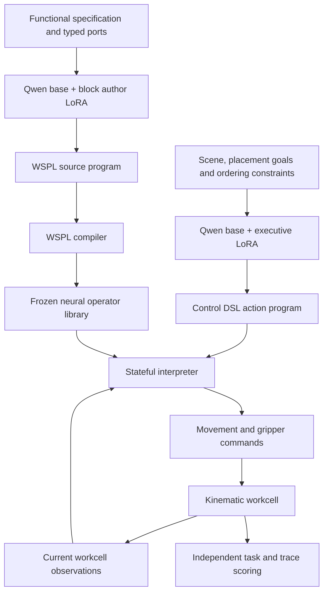

# WSPL: Weight Space Programming Language

**A typed programming interface for LLM-authored neural programs.**

WSPL investigates whether an LLM can construct, inspect and repair useful neural
controllers through programs with explicit semantics, rather than manipulating
opaque tensors alone. The intended executable artifacts are neural weights.
**Skillforge** is the robotics and reusable-skill testbed in this repository.

This is an early research prototype led by Kevin O'Connor. We distinguish a
program matching its weights, a controller satisfying an input-output contract,
and a robot satisfying a trajectory property. Each needs its own evidence.

## Current research status

**November 17, 2026 — neural controller authoring and composition:** a fine-tuned
Qwen2.5-Coder-1.5B author generated 96/96 behavior-correct WSPL neural blocks and
supported 32/32 composed workcell missions. A separately trained executive writes
programs using a frozen six-block library from that author. Its expanded curriculum
raised mission success from 124/224 to **210/224 (93.8%)** against the previous
executive on identical new scenes, with 86 improvements and zero regressions.
Training covered 2–5 objects; unseen 6–8-object missions scored **88/96 (91.7%)**.
These are supervised synthetic tasks in a planar kinematic workcell with supplied
planner labels and independent physical-state scoring. See the
[results and limitations](docs/wspl/NEURAL_CONTROLLERS_RESULTS.md).

**November 16, 2026 — neural control DSL prototype:** typed `move_to`, `grasp`,
`release` and reusable `transfer` programs now execute through frozen neural motor
and predicate blocks in a multi-object kinematic workcell. Explicit skill lifetimes,
independent completion checks and per-tick traces make composition inspectable.
64 engineering checks pass; supplied success and jammed-grasp fixtures are included.
No learned executive or physical-robot result is claimed. See
[design, limitations and reproduction](docs/wspl/NEURAL_CONTROL_DSL_V1.md).

**November 9, 2026:** the SmolLM capability and retention experiments are complete
and archived. Gradient-trained spatial adapters learned the bounded grid task,
but substantially degraded prose and ARC science performance when enabled.
Astra partially reduced that interference by scaling adapter outputs; it did not
rewrite the learned computation or use WSPL syntax in that repair. These studies
do not establish a WSPL advantage or general language-model capability programming.
No experimental adapter or repair is promoted into the supported design.
See the [current research handoff](CURRENT_RESEARCH.md) and
[completed results](docs/wspl/SMOLLM_EXPERIMENTS_2026-11-09.md).

## Current status

The WSP editor implements direct FP32 tensor editing, explicit affine/ReLU circuit
placement, immutable plans and frozen-artifact descriptions/checks. It now also
supports [graph surgery](docs/wspl/WSP_GRAPH_SURGERY.md): replace subgraphs,
transplant modules, rewire edges, add residual paths and untie shared weights in
stateless vector DAGs. Plans expose every boundary consumer and shared parameter.
The broader [tooling design](docs/wspl/WSP_TOOLING_DESIGN.md) and
[syntax](docs/wspl/WSP_SYNTAX_0_2.md) retain future extensions. The new frontend
preserves historical Core PWA semantics; engineering checks and completed
authoring screens are summarized under [Experiments](#experiments).

| Component | Status |
| --- | --- |
| WSPL 0.2 fixed-architecture editor | First pass: direct FP32 tensor construction, placed affine/ReLU circuits, plan/apply/inspect/diff/describe/check/probe CLI and APIs |
| WSPL 0.2 graph surgery | Stateless vector DAG replacement, transplantation, rewiring, residuals and explicit shared-weight separation; replayed plans and full edited-graph checks |
| Typed scalar JSON IR and exact rational interpreter | Implemented; engineering examples and negative checks |
| WSPL text front end (proposal module form) | Initial parser to JSON IR and contract suites; Core PWA only |
| Scalar IR to ReLU MLP weights, source map and independent loader | Initial implementation; fresh architecture only |
| Small real-graph I/O contract verifier | Initial Z3 prototype; non-vacuity and rational witness replay |
| Source IR to stored-weight equivalence check | Initial Z3 prototype; compiler-independent encoding, replayed differences |
| Numerical (IEEE) execution proof | Planned |
| Frozen MLP tensor import and parent/edited relational contracts | Initial G3a prototype; exact hex-float import with pre/postprocessing relays, Z3 relational checks |
| Output-patch composition and transactions | Initial G3b prototype; augmentation with verified slices, COMMITTED/REJECTED/UNRESOLVED gating, replayable manifests |
| Opaque-network intervention evidence | Paired activation probes, controls, replay and hash-chained empirical logs |
| Fresh LLM authoring | Native and matched native/WSPL Breakout screens completed; feedback-driven authoring remains planned |
| Small-alphabet LTLf compiler and strong finite-model planner | Implemented for supplied symbolic effect models |
| Hierarchical task expansion | Implemented at a supplied macro-summary cut; no physical primitive executor |
| Neural MLP/RMV blocks and single-tick LIBERO bridge | Implemented; independent sampled outcome observers |
| Pregrasp positioning pilot | Completed; scoped results below |
| Diverse robot tasks | 16 inspected specifications over 7 audited scene assets; contact/obstacle integration pending |

The proposal's first module form parses from text into the scalar JSON IR and
contract suites ([text front end](docs/wspl/PARSER.md)). The separate WSPL 0.2
editor implements the tensor/circuit and graph subsets linked above. The scalar
JSON IR compiles neural weights and supports scoped
real-graph contract checks. There is
no numerical execution proof. The available compiler command is documented below;
the proposal's general `wspl` command suite remains planned.

Try the supplied graph-edit example after installing the editor and verifier:

```sh
python -m pip install -e ".[editor,verify]"
python tools/demo_wsp_graph.py --output work/wsp_graph_surgery_demo
```

Choose a new output directory. The [example](examples/wsp_graph/README.md) replaces
one branch, adds a residual and separates a shared weight in three independent
candidates. It checks each intended change and preserved branch against the
actual stored graph. These are known-answer fixtures, not learned robot results.

The [graph stress checks](docs/wspl/WSP_STRESS_V1.md) now cover 100 seeded DAGs,
1,200 edit steps and preserved execution of three archived controller artifacts.
The [matched repair screen](docs/wspl/REPAIR_SCREEN_V1_RESULTS.md) completed:
**6/6 successes for direct editing and 6/6 with WSPL available**, across three
supplied circuit tasks and two fresh Astra draws each. All repair/preservation
claims and numerical checks passed. WSPL used `untie` in two proposals and raw
graph edits in four; general region replacement was not exercised. This is a
feasibility pass with a ceiling, not a comparative advantage or learned-controller
result. The twelve replies and independently replayed completion audit are archived.

The [reworked Breakout comparison](docs/wspl/BREAKOUT_REWORKED_V1_RESULTS.md)
completed and passed its descriptive feasibility rule. Three fresh WSPL policies
averaged **391.685** reward versus **370.516** for three native-edit policies on
the same original 20,486-parameter tanh network. All six were valid, with 1,000
paired episodes each. Across-proposal SDs were 125.2 and 120.0, respectively:
this small screen does not establish superiority. All WSPL proposals used
construction loops and exact arithmetic; their stored source was 56% shorter
and reported output-token use 20% lower in this run. Full plans, weights,
equations, scores and trajectories are retained, with
[all replies and sources archived](artifacts/wsp_breakout_v1/README.md).
The audit reconstructed every candidate and checked 6,000 episode records and
127,378 recorded actions. The subsequent [Kinetix repair screen](docs/wspl/KINETIX_REPAIR_V1_RESULTS.md)
also completed: all three native and three WSPL repairs succeeded in 1,024/1,024
episodes each, versus 0/1,024 for the parent. This is a success ceiling, not a
comparative performance advantage; all WSPL proposals used literal edits.

## Two learned adapters, from neural operators to action programs

**Current direction:** retain the compact executive syntax. The unified-language
repeat compiled256/256programs but scored191/224ordinary missions versus210/224for
the previous compact model; see the [completed comparison](docs/wspl/UNIFIED_EXECUTIVE_V1_RESULTS.md).
The [closed-loop study](docs/wspl/CLOSED_LOOP_V1.md) completed on November 18.
Across three seeds, feedback-driven execution scored151/192disturbed missions
versus48/192for frozen nominal plans:103paired improvements and zero regressions.
Reversing the actuators reduced long8 success from37/48to0/48; replacing only the
movement block restored exactly the same37successful missions. Authored, AdamW
and analytic replacements all achieved that recovery. The reversal rule was
supplied, not discovered. Long-horizon reliability remained weak and the full
progression criteria failed. This is a kinematic result; physics and hardware
require subsequent studies. The next proposed direction is documented below.

## Proposed experiment: agent-led capability engineering

**Updated November 19, 2026. Astra replaces Opus at Kevin's request.** The
[bounded first pilot](docs/wspl/ASTRA_ADAPTATION_V1.md) is being prepared: unknown
actuator response, twelve Astra responses maximum, neural movement replacement,
optional bounded fitting, and frozen deployment across all three saved executives.
Exact source approval is required before launch. The broader proposal below
includes future executive/harness editing that this first pilot does not expose.

Give Astra the working framework, pretrained models, controller artifacts and
diagnostic tools, and test whether it can build a reusable capability that the
starting system lacks. Allow it to investigate failures, edit neural blocks,
construct training examples and invoke bounded gradient training. Directly
guessing weights is one available method, not the imposed scientific objective.

The first proposed task is an **unknown change to actuator dynamics**. Provide
calibration scenes and observable action outcomes, withhold the mechanism and
the repair, and reserve new layouts for final evaluation. Freeze the resulting
system before evaluation and run it without Astra. A successful artifact must
generalize beyond the calibration episodes; Astra solving each test episode
interactively would answer a different question.

### Starting assets and training provenance

The starting assets are two independently trained adapters over frozen
Qwen2.5-Coder-1.5B-Instruct, plus the compiled six-block library. The author
generates WSPL source; compilation produces neural weights. The executive
selects compact actions using observed state. Neither is a learned simulator.

| Asset | Existing training recipe | Role in the proposed experiment |
|---|---|---|
| Neural-block author | 1,536 compiler-generated specifications across six operator families; two epochs,384updates,20warmup updates | Generate or revise controller programs from functional specifications |
| Closed-loop executive | Three fresh seeds113/227/341;16,384decision snapshots and256development snapshots; two epochs,4,096updates per seed,160warmup updates | Execute actions using observed outcomes; preserve all seeds in reporting rather than silently selecting the best |
| Six compiled neural blocks | Saved outputs of the trained author; frozen during executive training | Movement, proximity, holding, gripping and safety primitives; replace locally when needed |

Both author and executive use rank16/alpha32 LoRA with18,464,768trainable
parameters over attention Q/K/V/O and MLP gate/up/down projections. The base is
frozen. Training uses completion-only cross-entropy, microbatch1 with accumulation8,
AdamW peak LR0.0002, decay0.01, gradient clipping1, warmup followed by cosine decay
to10%, BF16 base computation and FP32 adapter/optimizer state. Context is2,048tokens
without truncation. These are the **existing asset recipes**, not a decided recipe
for future agent-directed training.

Executive supervision comes from reference trajectories on2–5object missions:
40%clean and20%each slipped grasp, moved object and blocked destination before
snapshot sampling. Whole missions belong to one split. The target is one action:
`transfer OBJECT to POINT`, `move_to OBJECT_OR_POINT`, `grasp OBJECT`,
`release OBJECT`, or `stop`. There is no gradient through the simulator and no
reward-based executive training in these starting assets. See the
[author protocol](docs/wspl/CONTROLLER_AUTHOR_V1.md) and
[closed-loop recipe](docs/wspl/CLOSED_LOOP_V1.md).

### Evidence motivating the next step

The completed closed-loop study achieved96/96familiar3–5object missions,
37/48long8,25/48long12 and28/48renamed12. Combined-disturbance success varied
substantially by seed:16/16,10/16and5/16. Ordering errors, omissions and revisiting
delivered objects remain executive limitations. All three replacement methods
restored the original per-task success pattern after the supplied actuator
reversal, without executive retraining. This supports local replaceability, not
autonomous mechanism discovery or superiority over gradients. The authored
movement block passed rational-real specification equivalence; that does not
prove floating-point execution or physical trajectory safety.

The new experiment asks the agent to bridge the missing step: determine what
changed from evidence and produce a durable repair. It should also expose whether
our tools help a capable engineer, rather than assuming the neural representation
is inherently better than code.

### Agent workspace, comparisons and evaluation

- Supply model loading, compact execution, WSPL compilation, weight inspection,
  trace diagnostics and bounded training tools. Log all tool calls, changes,
  data generation and training configurations.
- Keep the evaluator, success definitions, reserved scenes and interaction
  accounting outside the editable workspace. Hide mechanism implementation and
  future-event information; expose only the declared calibration interface.
- Begin with feasibility. If it works, compare Astra with ordinary Python
  controller tools against the same tools plus WSPL and the pretrained authors.
  Use common observations and budgets. This measures the added toolkit; isolating
  WSPL syntax from the pretrained authors would require another ablation.
- Include the untouched system, report calibration and reserved-task performance,
  and measure retention on unchanged dynamics. Record failures and regressions,
  not just the selected successful artifact.
- Attribute every improvement to its deployment location: harness code,
  executive weights, controller weights, or a combination. Report construction
  time, model tokens, environment interactions, gradient updates and inference
  cost separately.

Before implementation and launch, specify the exact Astra version/provider,
mechanism family, data splits, number of independent attempts, editable surfaces,
model-call and training budgets, stopping rules, deployment format and success
criteria. A fixed interaction/compute allowance is intended; numerical limits
have not yet been chosen. Any scientific run requires its own approved source
manifest. No full robotics or continual self-improvement claim follows from a
single successful repair.

### Related work and improvement memory

[EMPIRIC](https://arxiv.org/html/2609.35047v1) learns executable residual dynamics
on top of a physics engine, infers parameters and hidden state, and uses experiments
and simulation for planning. Our current blocks implement control rather than
predictive world models. Its experiment-driven identification loop motivates
withholding the changed mechanism in this proposal; our existing known-reversal
result does not establish that ability.

[Self-Improvement Memory Enables Continual Recursive Self-Improvement](https://arxiv.org/html/2611.18856v1), submitted November13, motivates retaining
the engineering history alongside executable artifacts. SIM conditions the
harness optimizer, while task-model weights remain frozen. It is evidence about
continued harness optimization, not demonstrated durable neural capability edits.

Adopt a small structured experiment memory as infrastructure, without adding a
separate memory-effectiveness study yet. Each entry records: problem hypothesis;
artifact/version; proposed modification and rationale; predicted outcome recorded
before evaluation; actual result and regressions; data/budget context; and links
to evidence. Preserve unsuccessful attempts as well as successes. Astra receives
the acquisition history, not reserved evaluation answers. Prior results can inform
design, but fresh confirmation scenes must remain outside its feedback loop.

For example: known actuator reversal; movement-only replacement; predicted
recovery without executive changes; observed restoration of the same37/48missions;
scope limited to supplied dynamics in a kinematic environment. The unresolved
question is whether an agent can infer an unknown change and achieve comparable
recovery. Extending memory-backed optimization to controller or executive weights
is our proposed experiment, not a result established by SIM.

## Architecture of the existing controller system

The controller experiments connect **two separately trained LoRA adapters on
Qwen2.5-Coder-1.5B-Instruct**. The **block author** generates WSPL programs that
compile into small neural controllers. The **executive** generates task programs
that call those controllers. A compiler constructs the neural weights, and a
stateful interpreter executes the action sequence against observations from the
workcell.

Both adapters generate text. Their outputs have different roles and execution
paths. The block library is built first and reused across executive missions.



### The block author learns to construct neural computation

The author receives a functional specification, named input/output ports and
numerical parameters. For a movement block, the specification asks for proportional
motion toward a target with a fixed command limit. A generated WSPL module contains
the computation below, together with its typed port declarations.

```text
vx = clip(0.73 * x, -0.07, 0.07);
vy = clip(0.73 * y, -0.07, 0.07);
grip = 0;
```

Here `x` and `y` are target-minus-position errors. The WSPL compiler constructs
ReLU weights implementing this function. The resulting network can be evaluated
repeatedly as the robot moves. The generated source, compiled weights and numerical
behavior checks are retained together.

The library contains six operator types. Every object and mission reuses the
selected operators with different inputs.

| Neural operator | Input | Output and purpose |
|---|---|---|
| `move` | Target error in two coordinates | Bounded movement commands |
| `near` | Target error | A proximity margin used to propose arrival |
| `holding` | Binary holding observation | A margin indicating grasp state |
| `close` | Declared planar inputs | Zero movement and a close-gripper command |
| `open` | Declared planar inputs | Zero movement and an open-gripper command |
| `safe` | Current position | A margin relative to the workspace boundary |

The executive experiments use the first saved six-block set from the trained
author's reserved outputs. Those compiled weights stay frozen throughout executive
training and evaluation. The original author pilot produced 96/96 numerically
correct blocks and supported 32/32 composed missions. Its train and evaluation
splits share the six functional families and use distinct full parameter
specifications. [Author protocol](docs/wspl/CONTROLLER_AUTHOR_V1.md)

### The executive learns to bind and order actions

The executive receives a structured scene with object positions, named destinations,
placement goals and constraints such as “deliver A before B.” It generates a
complete control DSL program one token at a time, attending to the task description
and its own generated prefix.

```text
transfer object_a to tray
transfer object_c to shelf
transfer object_b to buffer
move_to home
```

The model chooses the object bindings, destination bindings and instruction order.
The complete program is frozen before execution. During the current experiments,
the interpreter advances through that program using live state observations.
Executive replanning after an execution failure is future work.

`transfer object_a to tray` expands into four primitive calls.

```text
move_to object_a
grasp object_a
move_to tray
release object_a
```

Each primitive has a lifetime and a `running`, `success` or `failure` status.
`move_to` repeatedly calls the movement block, checks the proximity block and
monitors the safety predicate. `grasp` calls the close block and checks holding.
`release` calls the open block and checks that the hand is empty. The interpreter
checks neural completion proposals against observed geometry and holding state.
Finite budgets stop a stalled skill, and traces record block inputs, outputs,
commands and observations at each tick.

### How the two LoRA adapters were trained

Both adapters use supervised fine-tuning with teacher forcing. Each example
contains a user specification and a correct assistant program. The model predicts
each program token given the specification and the correct preceding tokens.
Cross-entropy is computed over the assistant program tokens, including its chat
termination. Backpropagation updates the LoRA matrices.

| Training choice | Block author | Expanded whole-plan executive (v2) |
|---|---|---|
| Input | Functional contract, ports and parameters | Scene, goals and ordering constraints |
| Target program | WSPL neural-block source | Control DSL action sequence |
| Label generator | Deterministic compiler-based generator | Deterministic topological-sort planner |
| Training examples | 1,536 | 16,384 |
| Training coverage | Six parameterized operator families | Missions containing 2–5 objects |
| Epochs | 2 | 2 |
| Optimizer updates | 384 | 4,096 |
| Warmup updates | 20 | 160 |

Each adapter has **18,464,768 trainable parameters**, rank 16 and alpha 32. LoRA
wraps the attention query, key, value and output projections, plus the MLP gate,
up and down projections. Both start with fresh adapter initialization over the
same frozen Qwen base. They are trained independently, and the executive uses its
own adapter weights.

The shared optimizer settings are AdamW with peak learning rate 0.0002, weight
decay 0.01, gradient-norm clipping at 1 and cosine decay to 10% of peak after
warmup. Microbatch size is one with eight-way gradient accumulation. The base
computes in BF16, with FP32 LoRA parameters and optimizer state. Examples must fit
the 2,048-token context without truncation.

The source of supervision is explicit. Compiler-generated examples teach the
author how to express the supplied functions in WSPL. Planner-generated examples
teach the executive how to satisfy a supplied ordering procedure, including an
alphabetical tie-break among currently available goals. Robot execution occurs
after training and supplies evaluation outcomes. The current training loss has
no gradient path through the compiler, neural controller library or simulator.

The code and exact training settings are documented in the
[author training primitives](src/skillforge/authoring_sft.py),
[author protocol](docs/wspl/CONTROLLER_AUTHOR_V1.md) and
[expanded executive protocol](docs/wspl/EXECUTIVE_CURRICULUM_V2.md).

### Decision-making and evidence

| Component | Responsibility |
|---|---|
| Learned block author | Writes the function that a neural block will implement |
| Deterministic compiler | Constructs weights from the WSPL program |
| Learned executive | Chooses and orders task actions and their arguments |
| Stateful interpreter | Calls the appropriate blocks, advances skills and handles failure |
| Neural operators | Calculate movement, gripper commands and predicate margins |
| Independent scorer | Checks final placement, delivery order and preservation of completed work |

The latest executive completes **210/224 ordinary missions**, compared with
124/224 for the previous executive on identical new scenes. Training covers
2–5 objects; evaluation on 6–8 objects yields **88/96 successes**. All 256 generated
programs compile. The same six neural blocks support every mission length.
The remaining ordinary failures omit deliveries, with some also violating order.

These experiments use a planar kinematic workcell, supplied state observations,
one held object and geometric grasp contact. The reference planner succeeds on
every evaluation panel. The experiments establish supervised construction and
composition within this setting. Contact physics, perception, obstacle avoidance,
learned recovery and generalization to new operator families need further study.
The expanded curriculum changes data volume, names, mission lengths, dependency
coverage and training budget together, so its measured gain applies to that combined
change. [Results, comparisons and archived evidence](docs/wspl/NEURAL_CONTROLLERS_RESULTS.md)

## WSPL syntax: programs that construct weights

### What the implementation actually accepts

The experimental **WSPL 0.3 unified frontend** now connects typed module
definitions, compiled-weight edits and typed task composition through
`skillforge.wspl_language.compile_source`. See the
[unification specification](docs/wspl/UNIFICATION_V1.md) and the
[executive repeat protocol](docs/wspl/UNIFIED_EXECUTIVE_V1.md). The
[completed repeat](docs/wspl/UNIFIED_EXECUTIVE_V1_RESULTS.md) did not preserve
long-mission performance; compact task syntax remains the preferred interface.

```text
wspl 0.3;
use robot = library("planar", sha256="ACTUAL_LIBRARY_SHA256");
task Mission {
  robot.transfer(parcel, tray);
  robot.move_to(home);
}
```

The actual digest binds the six typed neural artifacts and the skill ABI. Calls
compile directly to the existing interpreter's typed instruction IR. In the same
language, `module` defines a scalar function and `target base = compiled(Module);`
makes its compiled weights available to the editor. Rational-to-FP32 rounding is
recorded; edited weights do not inherit the original module's contracts. Runtime
library admission is explicit, so an edit cannot silently replace a deployed
controller. The current task skill set remains the planar workcell profile.

The following **legacy frontends remain supported** and explain the syntax used
in completed experiments. Their expression rules are stage-specific; 0.3 reuses
the typed module compiler and low-level editor rather than rewriting their
historical semantics.

| Source form | Purpose | Implementation |
|---|---|---|
| `module Name { ... }` | Define a typed scalar function and compile it into a ReLU network; used by the controller-block author | [Core PWA parser](src/skillforge/wspl_parse.py) |
| `wspl 0.2; target ...` | Construct/edit tensors, place circuits, and perform bounded graph surgery | [Editor parser](src/skillforge/wsp_syntax.py), [execution rules](src/skillforge/wsp_editor.py) |
| `transfer object to point` | Sequence calls to already constructed neural operators | [Action interpreter](src/skillforge/control_dsl.py) |

The [implemented syntax reference](docs/wspl/IMPLEMENTED_SYNTAX.md) specifies
statement forms, expression whitelists, names, comments, numerical profiles and
semantic restrictions. It describes shipped code. The older
[0.2 design document](docs/wspl/WSP_SYNTAX_0_2.md) also contains proposals.

**Core PWA module grammar.** In these grammar sketches, quoted text is literal,
`|` means an alternative, and `{ ... }` means repetition. Metavariables such as
`expr` are constrained by the rules below; they do not permit arbitrary code.

```ebnf
module     = "module" name "{" { statement } "}" ;
statement  = "input" port ":" port_type ";"
           | "output" port ":" port_type ";"
           | "let" port ":" let_type "=" expr ";"
           | port "=" expr ";"
           | ("ensures" | "preserves") name ":" "forall" "inputs" ":" formula ";" ;
port_type  = "Real" "[" constant "," constant "]" unit
           | "Truth" [ "[" constant "," constant "]" ] ;
let_type   = "Real" "[" constant "," constant "]" [ unit ]
           | "Truth" [ "[" constant "," constant "]" ] ;
```

Executable `expr` allows numeric constants, earlier input/let references,
parentheses, unary `+`/`-`, addition, subtraction, multiplication by a constant,
and division by a nonzero constant. Its complete function whitelist is:

| Function | Allowed arguments |
|---|---|
| `relu(x)` | One scalar |
| `clip(x, lo, hi)` | Scalar and constant bounds, `lo <= hi` |
| `margin(x, lo, hi)` | Scalar and constant bounds, `lo < hi`; produces graded truth |
| `min(a, b)`, `max(a, b)` | Two compatible scalar values |
| `not(p)` | One `Truth` value |
| `and(p, q)`, `or(p, q)`, `implies(p, q)` | Two `Truth` values; graded Lukasiewicz logic |

Ports/lets use lowercase names matching `[a-z][a-z0-9_]*`. Real input/output
ports require bounds and a unit label; `normalized_*` labels mean dimensionless
values. `Truth` is dimensionless and bounded within `[0,1]`. Only declared outputs
can be assigned, once each. Expressions cannot read outputs or forward references.
Units and conservative interval bounds are checked. There are no runtime loops,
imports, state declarations or products of two varying inputs in this frontend.

Contract `formula` permits affine comparisons (`<`, `<=`, `>`, `>=`, `==`),
`true`/`false`, parentheses and infix `and`, `or`, `implies`, with prefix `not`.
Contracts reference input/output ports; they do not call executable functions.
Parsing a contract does not prove it. Here `preserves` is an I/O contract keyword,
not an automatic comparison against an earlier network.

**Editor statement grammar.** A file starts with `wspl 0.2;`, declares exactly
one `target`, optionally declares constants/circuits/regions, then has at most
one `edit` block followed by optional `describe` blocks. Inside `edit`:

```ebnf
statement = tensor_selection ("=" | "+=" | "-=" | "*=") construction_expr ";"
          | "for" name "in" "range" "(" arguments ")" "{" { statement } "}"
          | "place" name "(" bindings ")" "at" "{" placements "}"
            "writes" "=" "replace_producers" ";"
          | "replace" name "with" artifact_expr "as" name "{" graph_fields "}" [ ";" ]
          | "transplant" artifact_expr "as" name "{" graph_fields "}" [ ";" ]
          | "add_residual" artifact_expr "as" name "{" graph_fields "}" [ ";" ]
          | "redirect" edge_expr "=" signal_expr ";"
          | "untie" parameter_expr "as" name ";" ;
```

The default `exact_to_storage` profile permits construction arithmetic
`+ - * / @`, numeric arrays, indexing/slicing, constants, current tensors and
`parent.W1`-style immutable reads. The complete construction function whitelist is
`copy`, `transpose`, `reshape`, `zeros`, `full`, `eye`, `f32bits` and `tensor`.
Construction arithmetic produces weights; it is separate from the circuit's
inference computation. Circuit placement currently accepts affine assignments
and an outer `relu(...)`, with every producer explicitly mapped to a compatible
neuron. Graph surgery requires `mode=graph`, a named host budget and explicit
boundary mappings. The reference gives the full declaration and evidence forms.

### Examples and execution model

WSPL 0.2 declares a target network and an explicit edit transaction. The following
runnable construction illustration adapts coordinate-weight assignments from an
[actual Breakout proposal](artifacts/wsp_breakout_v1/draw_1_wspl.source.wspl).
It illustrates syntax; it is not the complete game-playing controller.

```wspl
wspl 0.2;
target base=dense(widths=[600,32,32,6],activations=[tanh,tanh,linear],layout=in_out,storage=f32,init=zeros);

const gain=16;
edit base as candidate mode=fixed numeric=exact_to_storage {
  for r in range(10) {
    for c in range(10) {
      W1[6*(10*r+c)+3,15:20]=gain*[r,c,c,c,c];
      W1[6*(10*r+c)+4,0:2]=-10*gain*[c,r];
    }
  }
}
```

`W1` connects input rows to first-layer unit columns; `b1` is that layer's bias.
Here the input index names a grid cell and channel: channel 3 contains the ball,
and channel 4 its previous position. A few expressions populate coordinate-based
weights across the board. **Construction loops run once to produce weights.**
Inference executes the resulting fixed neural network, with no runtime loops or
policy code supplied by the author.

| Syntax | Meaning |
| --- | --- |
| `target base=dense(...)` | Declare shape, activations, layout, storage and zero initialization |
| `target base=artifact("name",sha256="...")` | Bind an existing artifact by exact identity; `...` must be replaced with its actual digest |
| `edit base as candidate mode=fixed` | Construct a new candidate without changing the parent's tensors or topology |
| `const gain=16;` / `for r in range(10) { ... }` | Named construction values and bounded expansion of repeated weight patterns |
| `W1[i,j]=v;` / `W2[0:4,0:4]=copy(W1[0:4,0:4]);` | Direct tensor writes, slices, broadcasts and statement-snapshot copies |
| `+=`, `-=`, `*=` | Update selected entries; later writes see the current candidate storage |
| `parent.W1[...]` | Read the original immutable tensor values |
| `numeric=exact_to_storage` | Exact rational construction arithmetic, rounded directly to FP32 at each assignment |
| `numeric=native_numpy_v1` | Historical native literal-edit arithmetic; this compatibility profile excludes loops and expressions |

Graph mode adds explicit operations on consumers and shared parameters. This
fragment was used successfully in the synthetic repair screen:

```wspl
untie parameter("n0.weight") as W_drive;
W_drive[0,0]=3;
```

Inside a graph-mode transaction with a host-supplied budget, `untie` gives that
consumer a private copy before the update. Other consumers retain the shared
weight. Region `replace`, `transplant`, `redirect` and `add_residual` operations
are also implemented; their boundary mappings and topology budgets are explicit.
See the [graph surgery guide](docs/wspl/WSP_GRAPH_SURGERY.md) for complete examples.

The editor interprets bounded construction syntax as data; it does not execute
arbitrary proposal Python. `plan` records the parent, candidate, write footprint
and rounding; `apply` replays the plan and checks identity. `describe` and `check`
attach separate evidence to frozen artifacts. Author-provided semantic labels
remain hypotheses. Formal checks cover the supported affine/ReLU real-graph
subset; editable tanh networks receive empirical execution checks, not proofs.
The [implemented editor guide](docs/wspl/WSP_EDITOR_FIRST_PASS.md) and
[study interface](docs/wspl/BREAKOUT_REWORKED_INTERFACE_V1.md) document the working
subset; the broader [syntax design](docs/wspl/WSP_SYNTAX_0_2.md) also includes
planned features. The historical Core PWA module frontend below is separate.

## Try the exact scalar reference

Python 3.11 or later. The reference core uses the standard library:

```sh
python -m pip install -e ".[dev]"
```

```python
import json
from pathlib import Path
from skillforge.wspl_core import ScalarProgram

program = ScalarProgram(json.loads(
    Path("examples/wspl/brake_patch.core.json").read_text(encoding="utf-8")))
result = program.evaluate({"d": "1/5", "v": "2/5", "a_base": "1"})
assert str(result["a"]) == "-1"
```

The same program can be written in the proposal's text form,
[brake_patch.wspl](examples/wspl/brake_patch.wspl), and parsed into this IR:

```python
from skillforge.wspl_parse import parse_module

parsed = parse_module(Path("examples/wspl/brake_patch.wspl").read_text(encoding="utf-8"))
assert str(ScalarProgram(parsed.program).evaluate({"d": "1/5", "v": "2/5", "a_base": "1"})["a"]) == "-1"
```

Constants and inputs are exact rational strings or integers; floating-point input
is not silently treated as an exact specification. The scalar IR supports affine
arithmetic, ReLU, clipping, normalization, min/max and graded Lukasiewicz logic.
Unit labels, bounds and acyclic references are checked. Conservative interval
analysis can reject a valid program when a stronger proof is needed.

See [the scalar core](docs/wspl/SCALAR_CORE.md),
[BrakePatch](examples/wspl/brake_patch.core.json) and
[ApproachP](examples/wspl/approach_p.core.json).

## Compile neural weights

```sh
mkdir work
python -m skillforge.wspl_compile examples/wspl/brake_patch.core.json --output work/brake_weights.json
```

Create the output directory first and choose a new file. BrakePatch compiles into
the proposed 3 -> 4 -> 2 -> 1 ReLU network, with 29 parameters. ApproachP compiles
into a 12 -> 6 -> 6 -> 4 network, with 148 parameters. Generated examples and the
independent loader are described in [the compiler notes](docs/wspl/COMPILER.md).
Optional Torch emission checks exact coefficient representation; floating-point
execution and universal contracts are not certified by compilation.

## Check contracts and investigate opaque networks

With `python -m pip install -e ".[dev,verify]"`, the initial verifier checks
serialized ReLU graphs using rational real arithmetic. The three BrakePatch
contracts and the approach bounds/direction contracts are solver-backed PROVED;
broken gain/input-order fixtures produce independently replayed counterexamples.
This does not establish source equivalence, IEEE execution or physical safety.
See [verification scope and examples](docs/wspl/VERIFICATION.md).

A separate check asks whether a compiled artifact computes exactly its scalar IR
source over the declared input box. Both committed examples are EQUIVALENT under
rational real semantics, and weight regressions return counterexamples replayed
through both interpreters:

```sh
mkdir -p work
python -m skillforge.wspl_equiv examples/wspl/brake_patch.core.json examples/wspl/brake_patch.relu.json --output work/brake_equivalence.json
```

This is not an IEEE execution proof or a proof-carrying certificate.

For networks outside that verifier, [intervention logging](docs/wspl/INTERVENTION_EVIDENCE.md)
records controlled activation replacements with baseline, no-op and repeat checks.
It supports tensor-valued PyTorch eval/stateless adapters, records identity/RNG
and output effects, and can replay/chain empirical evidence. Observed computational
effects are not semantic concepts, real-world causes or universal guarantees.

## Research program

The first proposed product workflow is **controller change review and repair**.
See the [customer validation plan and collaborator handoff](docs/PRODUCT_VALIDATION.md).
An inspected engineering demo compiles a controller, exposes a deliberate gain
regression with a replayed counterexample, and checks an operator correction:

```sh
python tools/demo_controller_review.py --output work/controller_review
```

Add `--include-opaque` in the tested Torch/NumPy environment to include paired
activation probes. This is a known-answer demonstration, not automatic repair,
customer validation or a scientific performance comparison.

The three studies cover fresh authoring, repair of independently trained artifacts
and frozen composition. They span discrete causal worlds, low-dimensional dynamics and
robot manipulation. Each compares direct weights, ordinary PWA code and WSPL,
with and without verifier feedback. All arms receive final verification.

The [experimental program](docs/wspl/EXPERIMENT_PROGRAM.md) separates mathematical
contracts, deployment numerics and physical outcomes. The proposed first screen
has 36 synthesis runs, but is not registered, funded, approved or launchable yet.
Astra is selected; spending authorization, sampling, fresh task freeze and isolated
collection controls remain pending.

The [formal experiment protocols](docs/wspl/FORMAL_EXPERIMENTS_V1.md) now specify
the first finite-domain authoring screen and subsequent learned repair/composition
studies. Implemented: six-arm trial kernel, common 541-parameter target, finite
verification, feedback firewall, budget/selection records, public request export
and source-gated offline grading. Isolated provider collection and frozen launch
settings for that six-arm screen remain pending. A separate native Breakout
authoring screen has completed, as reported below.

Initial claims are explicitly mapped to evidence in that protocol. Final selected
code/WSPL artifacts now receive a separate rational source-equivalence diagnostic;
Boolean task success alone does not establish source fidelity between test points.
The WSPL arm accepts Core PWA module text through the text parser; JSON IR remains
internal. Astra, target capacity and evaluation budgets stay matched across arms.

- [Structured study plan](experiments/plans/wspl_cross_domain_v1.json)
- [CSAIL comparison and product win conditions](docs/wspl/CSAIL_COMPARISON.md): useful performance, checked changes and less engineering/review effort; outperforming the published game score is optional
- [Completed Breakout artifact replay](docs/wspl/BREAKOUT_REPLAY_RESULTS.md): 511.828 mean return versus upstream 517.411; uniform control 0.551; 1,000 episodes each, CPU only, no model calls
- [Completed fresh Astra native authoring screen](docs/wspl/ASTRA_BREAKOUT_NATIVE_RESULTS.md): three one-shot policies, 3,000 evaluated episodes; all replies, usage and failed-attempt history archived
- [Earlier matched ReLU comparison](docs/wspl/BREAKOUT_MATCHED_V1.md): completed; interpretation paused during review of compiler/interface fairness
- [Reworked native/WSPL comparison](docs/wspl/BREAKOUT_REWORKED_V1_RESULTS.md): completed on the original tanh network; performance, token use and replayable artifacts summarized below
- [Implementation gates](docs/wspl/WSPL_IMPLEMENTATION.md)
- [Original supplied WSPL proposal](docs/wspl/PROPOSAL_v0_1_2026-11-03.md), archived unchanged with provenance
- [Related work](docs/RELATED_WORK.md); compilation and neural repair have substantial precedents

## Experiments

### Neural operators and learned task composition

Two small-model training stages connect WSPL neural operators to executable robot
task programs. The author learns to produce typed ReLU blocks from functional
specifications. The executive learns to bind and order actions using frozen blocks
for movement, proximity, holding, opening, closing and workspace boundaries.

```text
transfer object_a to tray
transfer object_b to buffer
move_to home
```

The executor expands each transfer into approach, grasp, transport and release,
reusing the same neural weights. It logs neural inputs/outputs and observations,
checks completion, and enforces finite skill lifetimes. Independent scoring checks
all final placements, delivery order and preservation of completed work.

| Expanded-curriculum evaluation | Previous executive | New executive |
|---|---:|---:|
| Three objects | 32/32 | 32/32 |
| Four objects | 19/32 | 32/32 |
| Five objects | 18/32 | 32/32 |
| Six objects | 14/32 | 32/32 |
| Seven objects | 13/32 | 28/32 |
| Eight objects | 10/32 | 28/32 |
| Eight objects, new identifier format | 18/32 | 26/32 |
| Jammed final grasp, safe failure with progress preserved | 13/32 | 28/32 |

The deterministic reference satisfies every panel. All 256 new executive programs
compile. The 14 ordinary failures omit deliveries, with five also violating order.
The jammed panel measures bounded failure handling provided by the interpreter
together with the generated program. The study uses one training seed and changes
data volume, task length, names and dependency coverage together. Physical contact,
perception and obstacle avoidance remain outside the implemented workcell.

[Detailed results and protocols](docs/wspl/NEURAL_CONTROLLERS_RESULTS.md) ·
[Programs, scores and representative traces](artifacts/neural_controllers) ·
[Executable DSL](src/skillforge/control_dsl.py)

### Ordinary Python versus neural prediction programs

A follow-up added six ordinary Python predictors to the completed small-data
panel, reusing the existing native WSP, WSPL and AdamW results. All six were valid.
With the same 128 acquisition examples and two-response validation budget,
**Python achieved lower prediction RMSE than both neural authoring interfaces on
five of six tasks**, and beat both AdamW baselines on all six. ERCOT favored the
neural predictors; Dominick still favored a simple training-mean predictor.

Causal effects diverged from factual accuracy: IHDP effect RMSE favored Python
(0.375 versus native 1.654 and WSPL 2.945), while ACIC strongly favored native WSP
(0.0137 versus Python 0.0826 and WSPL 0.1222). Python used explicit nonlinear
formulas and example-based prediction, without an executable optimizer.

This exploratory, one-draw comparison weakens the case for neural deployment as
the default for standalone prediction. Python had greater expressivity; public
dataset familiarity, reused partitions and limited gradient baselines also limit
interpretation. WSPL's integration, composition and verification benefits need
separate evidence. No neural reruns were needed.

See the [full results](docs/wspl/PYTHON_ADDITION_RESULTS.md),
[audit](docs/wspl/PYTHON_ADDITION_RESULTS_AUDIT.json), and
[final programs](artifacts/python_addition_v1/).

### Small-data prediction panel: forecasting, regression and causal outcomes

The completed stage-one panel contains 24 problems (14 forecast series, eight
regressions and two causal instances), with one draw each of native WSP, WSPL,
Astra-guided AdamW and fixed AdamW. All 96 final candidates were valid. Methods
shared at most 128 acquisition examples and the same small ReLU architecture;
direct authors constructed weights without executable fitting. All candidates
were frozen before test scoring.

| Direct author | Lower factual RMSE than fixed AdamW | Lower factual RMSE than guided AdamW | Best of four |
| --- | ---: | ---: | ---: |
| Native WSP | 22/24 | 20/24 | 14/24 |
| WSPL | 24/24 | 23/24 | 9/24 |

WSPL used 342,036 output tokens versus native's 622,124 (including reasoning),
approximately 45% fewer, and approximately 43% less authoring time. Native won
14 of their 24 head-to-head accuracy comparisons. These are descriptive results,
not evidence of WSPL accuracy superiority or a compute-matched comparison.

Causal effects require separate evaluation: native's ACIC effect RMSE was
0.01368 versus WSPL's 0.12219, and WSPL estimated the wrong ATE sign despite
better factual prediction than either gradient arm. All neural methods also
lost to a training-mean predictor on three problems. One draw, small samples,
limited AdamW baselines and possible public-data pretraining exposure constrain
the interpretation.

See the [results and limitations](docs/wspl/PANEL_STAGE1_RESULTS.md) and
[compact audit](docs/wspl/PANEL_STAGE1_RESULTS_AUDIT.json). Full local evidence
is preserved; no automatic expansion follows this panel.

### Go: constructing neural policies without gameplay feedback

Six Astra/xhigh sessions programmed a fixed 1.48M-parameter ReLU policy from
zero weights: three using Python/NumPy, three using WSPL. Each had up to eight
response/construction steps, with construction diagnostics but no gameplay,
policy-output feedback or gradient training. All candidates were frozen before
42,000 CPU games against three same-size PPO opponents, including a zero control.

| Authoring draw | Python/NumPy win rate | WSPL win rate | WSPL minus Python |
| --- | ---: | ---: | ---: |
| 1 | 42.52% | 38.28% | -4.23 pp |
| 2 | 32.67% | 30.92% | -1.75 pp |
| 3 | 21.32% | **52.15%** | **+30.83 pp** |
| Mean | 32.17% | **40.45%** | **+8.28 pp** |

Rates average 6,000 games per policy over the three opponents. Zero control:
1.62%. WSPL's best policy exceeds the best Python policy by 9.63 percentage
points. The large third-pair win outweighs two smaller losses, but three authoring
replicates do not establish a reliable language advantage. These are opponent
win rates, not direct Python-versus-WSPL matches.

The strongest WSPL session repeatedly refactored explicit liberty, vulnerability,
connection and eye-handling computations inside the fixed network, using tensor
edits, loops, slices and parent references. It did not use graph growth or the
high-level circuit-placement syntax. Semantic correctness of its claimed
"certificates" and the contribution of individual edits remain unverified.
Python also produced explicit tactical circuits. WSPL used more reported input
and output tokens in this screen; there is no token-efficiency win here.

One Python request timed out before returning an answer. Recovery preserved four
frozen candidates byte-for-byte and completed the remaining pair; the failed
call's usage is unknown. All six candidates constructed successfully. This is a
smaller construction-budget screen than the original CSAIL experiment, not a
strict reproduction. See the [results and accounting](docs/wspl/GO_AUTHORING_V1_RESULTS.md),
[protocol](docs/wspl/GO_AUTHORING_V1.md), and
[recovery protocol](docs/wspl/GO_AUTHORING_RESUME_V1.md).

The [seven-edit review](artifacts/go_edit_sequence_v1/index.html) preserves exact
patches, source diffs, changed-weight lists and per-call usage/length metrics.
Paired evaluation peaked at edit 3 (54.13%) before declining to the final 52.15%;
all 189 final-checkpoint batches reproduced the earlier evaluation exactly.
This is post-hoc analysis on the original seeds, not held-out checkpoint selection.

### Diffusion: controlled coordinate editing

[Released-model replay](docs/wspl/DIFFUSION_REPLAY_V1_RESULTS.md) produced 3,072
images from three small ReLU denoisers using a declared DDPM reconstruction.
In the subsequent [Python versus WSPL comparison](docs/wspl/DIFFUSION_EDIT_V1_RESULTS.md),
all six fresh Astra programs correctly shifted generated images two pixels right
with wraparound. Each program transferred to all three models: 18/18 applications
passed, with bit-identical edited weights per parent and exact real-graph
permutation witnesses. This was a known coordinate transformation, not semantic
feature discovery or general graph surgery.

WSPL used 2,710 reported output tokens versus Python's 3,260 (16.9% fewer),
driven by reasoning tokens; non-reasoning output was slightly larger. Local
construction took 54.8s versus 9.1s. Both arms reached the task ceiling, so this
establishes feasibility rather than an accuracy or general efficiency advantage.
WSPL used loops and tensor copies, not circuit placement. The complete screen
finished in 4.04 minutes. [Raw programs and replies](artifacts/diffusion_edit_v1/index.json)
and [audit](docs/wspl/diffusion_edit_v1_audit.json) are retained.


### Kinetix: repair of a supplied trained controller

Six fresh Astra/xhigh proposals edited the same 171,664-parameter FP32 parent,
with identical task information, fixed topology and 1,024 paired episodes each.
The parent scored 0/1,024; **every native and WSPL repair scored 1,024/1,024**.
The descriptive feasibility rule passed, with no task-performance advantage.

WSPL used 29,706 output tokens versus 38,315 native (**22.5% fewer**, including
reasoning). That aggregate difference is largely driven by one native draw;
median output use differs by only 3.3%, and input+output totals by 0.78% because
the supplied weights dominate context. All WSPL programs chose the
native-compatible literal profile.

Across three proposals, WSPL used **97 edit statements versus 112** and
**1,949,335 charged construction operations versus 2,487,951** (21.6% fewer).
These counters measure editor work, including tensor processing, not inference
FLOPs; both arms still execute the same dense architecture. The larger third
native repair drives much of this aggregate difference. Five of the six fresh
repairs used 24–36 statements, compared with 51 in the published repair; the
published float64 replay is historical context, not a matched control here.

The protocol deliberately excluded circuit placement and graph surgery to hold
topology fixed. Constants, exact arithmetic and loops were available but unused.
Literal edits sufficed for these compact run-up controllers; presenting the
compatibility profile first may also have influenced selection, but that is an
untested explanation. This establishes useful repair through either interface,
not an advantage from richer constructs. The next discriminating comparison
should allow structured surgery alongside equivalent raw graph access and test
preservation obligations or varied conditions.
[Results, limitations and audits](docs/wspl/KINETIX_REPAIR_V1_RESULTS.md);
[all replies and source programs](artifacts/wsp_kinetix_v1/README.md).

### Matched native versus WSPL: performance and token efficiency

Six fresh Astra/xhigh proposals used the same task information, zero-initialized
20,486-parameter tanh network and 1,000 paired evaluation episodes per policy.
Three proposals used native literal weight edits and three used the rebuilt
WSPL interface. All six were valid. No author received tools, evaluation feedback
or gradient training.

| Measure | Native | WSPL | Observed change with WSPL |
| --- | ---: | ---: | ---: |
| Mean reward across three proposals | 370.516 | 391.685 | +5.7% |
| Best proposal reward | 498.366 | 524.558 | +5.3% |
| Total output tokens, including reasoning | 66,085 | 53,167 | 19.5% fewer |
| Reasoning output tokens | 55,737 | 49,137 | 11.8% fewer |
| Other output tokens | 10,348 | 4,030 | 61.1% fewer |
| Stored executable source bytes, all three | 16,185 | 7,131 | 55.9% fewer |

Token and byte totals cover all three proposals per arm; reasoning and other
output tokens partition total output. Input totals were closely matched:
12,177 native versus 12,186 WSPL. Native stored sources include their post-hoc
WSPL normalization wrapper, which was never supplied to either writer.

All three WSPL programs used construction loops and exact arithmetic. Repeated
weight patterns could be expressed once and expanded by the editor. The largest
token reduction was in non-reasoning output, consistent with more compact weight
construction. These observations motivate a larger efficiency study; they do
not establish why reasoning usage changed or a general cost advantage.

For the best pair in this screen, WSPL used **2,864 source bytes versus 5,913**
(51.6% fewer) and **17,504 total output tokens versus 19,308** (9.3% fewer),
while scoring 524.558 versus 498.366. Our best earlier native policy scored
**541.818**, above the best WSPL score here; that earlier prompt package and
evaluation seeds differ, so it is historical context rather than a matched control.

Across-proposal reward SDs were 120.0 native and 125.2 WSPL. **Three authoring
draws per arm do not establish performance superiority or a reliable efficiency
advantage.** The predeclared descriptive progression criterion passed. No formal
tanh/controller proof is claimed, and shorter source is not itself evidence of
easier human review.

All replies, sources, weights, edit plans, equations, episode records and the
first three trajectories per policy were retained. The audit reconstructed all
six candidates, checked all 6,000 episode records and replayed 127,378 recorded
actions from their observations and RNG states.

- [Full results and limitations](docs/wspl/BREAKOUT_REWORKED_V1_RESULTS.md)
- [Best matched WSPL program](artifacts/wsp_breakout_v1/draw_0_wspl.source.wspl)
- [Best matched native program](artifacts/wsp_breakout_v1/draw_0_native.answer.md)
- [Best historical native program](artifacts/astra_breakout_native_v2/draw_1.answer.md)
- [All six replies and executable sources](artifacts/wsp_breakout_v1/README.md)

### First fresh native weight-authoring screen: Breakout

In a supplied-rule pilot, **Astra authored functioning neural Breakout controllers
in one response per draw**, using the original CSAIL compact weight-edit syntax.
Each starts from a zero-initialized 600 -> 32 -> 32 -> 6 tanh network with 20,486
parameters. Three separate fresh conversations received the same game rules and
source, with no reference solution, evaluation feedback or gradient updates.

| Fresh policy | Episodes | Mean return | Episode standard error |
| --- | ---: | ---: | ---: |
| Draw 1 | 1,000 | 484.756 | 4.469 |
| Draw 2 | 1,000 | 541.818 | 5.000 |
| Draw 3 | 1,000 | 510.042 | 7.755 |

The three-policy mean is **512.205**. Our separate released-policy replay scored
511.828 and its uniform control 0.551; those used different evaluation seeds and
provide context rather than a paired superiority test. Every fresh policy used
the same 1,000 evaluation seed pairs. All 3,000 episodes, including horizon
truncations, are retained. All edits parsed successfully, and the event logs show
one completed turn and zero tool calls per draw.

The completed run took 41.1 minutes, including 29.7 minutes collecting replies.
Reported usage: 10,020 input tokens (3,200 cached) and 65,775 output tokens,
including 55,638 reasoning tokens. An earlier invocation aborted on a CLI startup
warning is also recorded; its usage is unknown. The read-only audit checks source
identity, raw-file hashes, reply-to-weight reconstruction and every episode record.

This demonstrates useful native weight authoring on one supplied task. The later
matched WSPL comparison is reported above; a gradient-trained control and formal
controller proof remain future work. See the [full results and limitations](docs/wspl/ASTRA_BREAKOUT_NATIVE_RESULTS.md),
[machine-readable audit](docs/wspl/astra_native_v2_results.json) and
[all three authored replies](artifacts/astra_breakout_native_v2/README.md).

## Path to Recursive Twin Improvement

**Recursive Twin Improvement (RTI)** is a proposed learning loop in which two
frontier-model instantiations take turns editing each other's weights. Each edit
must demonstrate independently evaluated improvement in the target domain while
satisfying required contracts and preservation criteria before it is accepted.

WSPL is intended to make these edits explicit, executable and checkable. Accepted
and rejected proposals, counterexamples, artifact identities and evaluation
outcomes would form training data and rewards for models to become better weight
editors. This couples two objectives: improving the target's domain capability
and improving the editor's ability to produce useful weight changes.

The proposed twin cycle is:

1. Model A proposes a weight edit to model B.
2. An independent evaluator checks the edited artifact, domain improvement and
   preservation of required behavior. Accept the edit only if those criteria pass;
   otherwise retain the previous target version and record the failed proposal.
3. Model B proposes an edit to model A under the same evaluation rules.
4. Alternate roles, retaining the edit histories and using their outcomes to
   train and test subsequent editing ability.

The evaluator, requirements and protected evaluation data remain outside the
twins' editable state. Mathematical contract results and empirical domain scores
are recorded separately: a measured improvement is not a universal guarantee,
and opaque-network intervention logs are not proofs. The current verifier covers
small supported graphs, not arbitrary frontier-model edits.

An accessible precursor uses frontier models as editors of smaller networks with
editable weights. Genuine frontier twins additionally require editable frontier
weights. The planned authoring and learned-repair studies would test prerequisites;
RTI, reward-based editor training and recursive capability gains are not implemented
or demonstrated here.

The decisive experiment must show that later versions become better **editors**,
as well as better domain models. Compare the alternating loop with a fixed editor,
self-editing and independent training at matched compute, using fresh evaluation
tasks. Successful alternating edits alone do not establish recursive improvement.

## Existing robot evidence

A small, unblinded engineering pilot compared six controllers on positioning at
a supplied standoff above an object. Each neural block had about 1,600 parameters.

| Controller | Successful evaluation starts |
| --- | ---: |
| Zero translation | 0/8 |
| Reference proportional controller | 8/8 |
| Analytic MLP weights encoding the reference | 8/8 |
| Analytic RMV weights encoding the reference | 8/8 |
| AdamW MLP, four demonstrations | 5/8 |
| AdamW RMV, four demonstrations | 3/8 |

The complete attempt took 56.266 recorded CPU seconds. RMV/scalar discrepancies
on recorded visited inputs were below 3e-8. This is empirical numerical agreement,
not a universal floating-point guarantee. Earlier failed attempts and costs are
retained in the [audited report](docs/APPROACH_V1_RESULTS.md).

These were inspected analytic encodings of a known controller, not a blinded LLM
synthesis result. The task was pregrasp positioning, not grasping, pickup, general
transfer or physical hierarchy execution. Four demonstrations did not reliably
teach the same closed-loop behavior; a general LLM-over-gradient advantage is not
established.

## Robotics testbed

The selected stack is MuJoCo for physics, robosuite for robot/control infrastructure,
and LIBERO for tasks and assets. The local adapter was checked against MuJoCo
3.2.7, robosuite 1.4.1 and a pinned LIBERO checkout. Simulation is optional and
must be installed/configured separately; reference tests do not launch it.

- [System specification](docs/SYSTEM_SPEC.md) and [adapter contracts](docs/SIM_ADAPTER.md)
- [Sixteen robot task specifications](docs/ROBOT_TASK_SUITE.md): repeated grasps,
  sorting, drawer/door chains, barriers, blocker clearance, timed holding and recovery
- [Symbolic hierarchy fixtures](docs/HIERARCHICAL_TASKS.md)
- [LTLf compilation and strong planning](docs/M1_ENGINEERING.md)

Obstacle/articulation/orientation inputs, contact-ready skills, independent
physical observers and the primitive executor remain explicit integration work.
An existing BDDL scene is not a working Skillforge task.

## Checks and reproducibility

```sh
python -m unittest discover -s tests -v
```

The suite now contains 426 checks: 425 pass in the primary research environment,
with the native MinAtar fixture skipped there. All 12 replay fixture checks pass
in the separate MinAtar CPU environment, including that fixture. Fifty editor
checks cover tensor compatibility, placement, transactions and evidence; fifty
graph checks cover cut boundaries, rewiring, shared storage, budgets, rollback,
CLI/examples and edited-graph claims. The [validation receipt](docs/wspl/wsp_graph_surgery_validation.json)
records the graph milestone; [repair preparation](docs/wspl/wsp_repair_preparation_validation.json)
adds 18 harness checks and current source identities. Optional neural/adapter checks
skip when PyTorch or NumPy is absent, and solver checks skip without Z3; full local results used a separate CPU
research environment. No model download, simulator rollout, scientific training
run or LLM API call occurs in the unit suite. A single optimizer transaction is
used only as a checkpoint/gradient unit fixture.

[Current validation receipt](docs/wspl/wsp_editor_first_pass_validation.json) and
[test output](docs/wspl/wsp_editor_first_pass_unit_tests.txt) record the checked
sources; earlier receipts remain historical records. Scientific runs require an exact user-approved source
manifest through [the source gate](experiments/source_pins/README.md). Historical
pins are preserved, not refreshed to match later development. Model weights,
datasets, credentials and machine-specific bindings are excluded from Git.

The [archive check](docs/github_archive_check.json) also records 132 passing tests
from a fresh GitHub clone, using the existing external CPU dependencies.

Install simulator environments **outside this checkout** for source-gated runs;
the local-source gate rejects unpinned package code inside the repository. Use
ignored `artifacts/local_paths.json` for machine bindings.

## Project record

- [Working context](docs/CONTEXT.md)
- [Evidence and limitations](docs/EVIDENCE.md)
- [Research roadmap](docs/ROADMAP.md)
- [Provenance](provenance/README.md)
- [Research coordination contract](AGENTS.md)

This repository preserves code, proposals, results and negative findings for the
ongoing research program. It is separate from legacy Gravemind, RBL-RMV and TNST
projects; their artifacts are not silently relabelled as WSPL results.

GitHub: https://github.com/k-oconnor/WSPL (private research archive).
No redistribution license has been selected. Nothing in the proposed experiment
program authorizes new API spending, training, deployment or physical hardware use.
