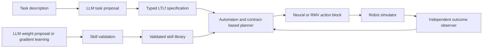

# Skillforge

**LLM-programmed neural and interpretable RMV skills, composed through finite-trace temporal programs.** Working name, confirmed by Kevin O'Connor; revisit branding later.

An LLM proposes a task specification in LTLf and implementations of small closed-loop skills. A checked compiler and planner select skills under explicit contracts. An independent observer verifies what happened. Validated skills become a reusable library; changing one mechanism should permit local repair.



The diagram describes the proposed robot system. This repository currently implements **reference semantics, a small-alphabet LTLf compiler, and strong strategy synthesis/execution in supplied finite skill-effect models**. Robot integration and neural skill acquisition remain planned.

## Simulation stack

We use the following open-source research software as the selected simulation stack:

- **[MuJoCo](https://github.com/google-deepmind/mujoco):** physics, including motion, collisions, friction and contact.
- **[robosuite](https://github.com/ARISE-Initiative/robosuite):** robot models, controllers, cameras and manipulation environments built on MuJoCo.
- **[LIBERO](https://github.com/Lifelong-Robot-Learning/LIBERO):** tasks and datasets organized to evaluate learning and transfer, using robosuite environments.

This selects the software stack. Compatible versions, task definitions, observations and controller settings will be audited and pinned before the first robot experiment; installation and execution are not yet implemented here.

## Start here

- [System specification](docs/SYSTEM_SPEC.md): interfaces, temporal semantics, execution, RMV fidelity and guarantees.
- [First experiment](docs/EXPERIMENT_01.md): LLM/gradient acquisition × MLP/RMV, costs, held-out composition and repair.
- [Roadmap](docs/ROADMAP.md): implementation stages and evidence required to advance.
- [M1 engineering notes](docs/M1_ENGINEERING.md): compiler semantics, strong planning, limits and executable discrete example.
- [Hierarchical task suite](docs/HIERARCHICAL_TASKS.md): reusable pickup/placement/transfer/group routines, prerequisite tasks, repeated calls and recovery fixtures.
- [Prior evidence](docs/EVIDENCE.md): completed toy-world experiments and their limits.
- [Related work](docs/RELATED_WORK.md): what is established and where this proposal could contribute.
- [Task example](examples/pick_place.task.json), [skill contract](examples/lift.skill.json), [RMV graph](examples/lift_gate.rmv.json).

## What exists

| Component | Status |
| --- | --- |
| Typed JSON task/skill/RMV schemas | Provided |
| Direct LTLf semantics on completed finite traces | Implemented reference; unit-tested |
| Scalar grounded RMV evaluation including affine motor readout | Implemented reference; unit-tested |
| Source-identity gate and empty approval registry | Provided; gate tests copied with provenance |
| Small-alphabet LTLf-to-DFA compiler | Implemented with explicit construction limits |
| Strong finite-model strategy synthesis and abstract executor | Implemented; all declared outcomes must reach acceptance |
| Supplied hierarchy expansion and macro-summary task fixtures | Implemented; nested primitive execution remains planned |
| LLM task translation / weight-authoring harness | Planned |
| Differentiable MLP/RMV skills and robot adapter | Planned |
| Robotic acquisition, composition or repair results | Not run |

## Reference checks

Python 3.11 or later. Reference evaluators use only the standard library. Schema tests additionally use `jsonschema`:

```sh
python -m pip install -e ".[dev]"
python -m unittest discover -s tests -v
```

No simulator, model download, training, LLM API call or hardware control occurs in those tests. LTLf evaluation applies to a **closed, nonempty trace**; a false unfinished prefix is not a failure verdict. Logical propositions describe observed state, commands or verified skill outcomes; action blocks themselves are executable policies.

After installation, compile a task or synthesize/execute the supplied discrete pickup fixture:

```sh
python -m skillforge compile examples/pick_place.task.json --output work/pick_place.dfa.json
python -m skillforge plan examples/discrete_pickup.task.json examples/discrete_pickup.model.json --initial start --execute --outcome-choice last --output work/discrete_pickup.plan.json
```

The second command deliberately selects the timeout/failure branches. The synthesized strategy recovers under the fixture's explicitly bounded-failure assumptions. These are engineering fixtures, not robotic or learned-skill results. Output files are created exclusively; choose a new path for another run.

For a task with a blocker dependency and reusable subtasks:

```sh
python -m skillforge hierarchy examples/hierarchical_tasks.json --case clear_then_retrieve --execute --output work/clear_then_retrieve.json
```

The root leaves its two goals unordered; the supplied effect model forces clearing access before retrieving the target. The hierarchy is given, and its pickup/placement bodies are abstracted by outcome contracts rather than physically executed.

## Research questions

1. Can LLM-authored weights acquire reliable skills using fewer interactions or less total time than gradient learning?
2. Can grounded RMV implementations retain useful performance while providing exact computational explanations of motor outputs?
3. Do independently validated skills transfer to unseen temporal compositions without internal retraining?
4. Can changing one mechanism be handled by local repair while preserving still-valid behavior?

LTLf planning, LLM-generated robot programs and skill libraries already have substantial prior work. Novelty must be assessed around weight-authored, faithfully compiled RMV skills, their acquisition cost and compositional repair. The toy-world evidence supports supplied factorization; it is not robotic validation or evidence that LLMs outperform gradient-trained skills.

## Repository boundaries

This is a new local repository, separate from Gravemind and legacy RBL/TNST robot models. [Provenance](provenance/README.md) links the antecedents without copying datasets or checkpoints. No GitHub remote, publishing configuration or redistribution license has been selected. Future scientific runs require exact source approval under [AGENTS.md](AGENTS.md); the current specification authorizes no run automatically.
