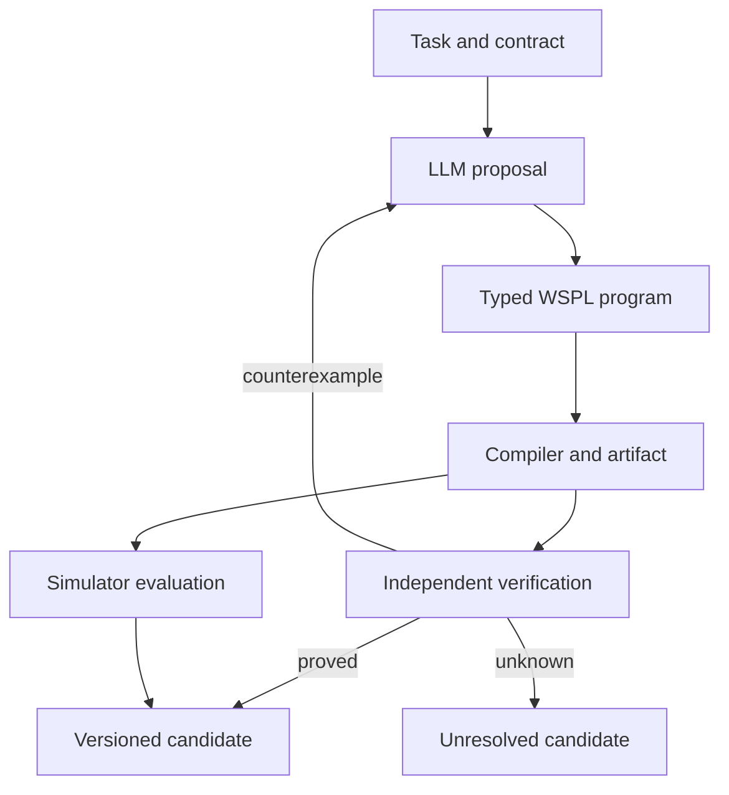

WSPL is a proposed Weight Space Programming Language for constructing, inspecting, and repairing neural controllers through programs with explicit numerical semantics. Its first target is an existing workflow in which an LLM successfully authors robot-controller weights. The objective is to turn those edits into executable, inspectable programs with independently checkable behavioral contracts.

Version 0.1 is an implementation and research specification, dated November 3, 2026. The language, APIs, examples, and milestones below are proposed interfaces, not implemented capabilities. Robot architecture, observation layout, actuator semantics, and simulator are adapter inputs; no particular existing controller is assumed.

The initial deliverable is a complete vertical slice: a WSPL controller or patch, a reference interpreter, compiled weights, an independently checked contract, and an experiment comparing the result with direct LLM weight authoring.

# Research objective

Test whether a symbolic intermediate language improves the reliability, editability, and certification of LLM-authored neural controllers without losing their practical task performance.

The central hypothesis is that restricting candidate computations to a compositional language makes useful behavioral changes easier to specify and verify. The LLM supplies proposals; the mathematical semantics and verification machinery determine which claims are accepted.

Three claims must remain separate:

| Claim | Required evidence |
| - | - |
| The explanation matches the installed computation | Compiler fidelity or a certified abstraction bound for the actual artifact |
| The edited controller satisfies a behavioral contract | Verification over the specified observation or state domain |
| The robot satisfies a trajectory property | Closed-loop reasoning including dynamics, observation error, disturbances, timing, and initial states |

An empirical improvement is useful even when a proof is unavailable. It must retain an empirical label.

# Scope and language profiles

WSPL has a small verifiable core and explicit extension profiles. Unsupported constructs are rejected by a selected backend rather than silently approximated.

| Profile | Expressiveness | Intended evidence |
| - | - | - |
| Core PWA | Bounded affine arithmetic, ReLU, clipping, min, max, Łukasiewicz operators, static composition | Real-arithmetic equivalence and bounded input-output contracts |
| Stateful | Explicit bounded state, synchronous updates, fixed-rate execution, finite-horizon temporal contracts | Bounded transition-system verification; invariant proofs where available |
| Learned bindings | Imported neural subgraphs, latent projections, symbolic abstractions | Artifact verification and separately stated abstraction or grounding evidence |
| Transformer | Bounded sequence operations and selected transformer modules | Restricted or conservative guarantees; backend-dependent |
| Numerical deployment | Concrete dtype, operator kernels, and quantization | Execution-level proof or a validated error enclosure |

Version 0.1 implements Core PWA on small feedforward controllers. Stateful execution and closed-loop model verification are the next extensions. Whole-model language semantics, unrestricted recurrence, arbitrary learned multiplication, general division, and semantic concepts such as honesty are outside the initial core.

A bounded loop may be statically unrolled. An unbounded loop is not accepted in Core PWA.

# System architecture



Verification and simulation produce separate results. A candidate can perform well in simulation while its universal contract remains unresolved, or satisfy a contract while failing the task objective. Neither result overwrites the other.

The LLM can inspect counterexamples, activations, symbolic expressions, and weight layouts. It cannot alter the evaluator, contract, input domain, or acceptance policy during a fixed benchmark. Changes to the specification create a new task version.

# Types and numerical semantics

Core types are Bool, Truth, bounded Real, fixed-shape Tensor, and named records. Truth is a real value in [0,1], not a probability. Bool is used in specifications; hard comparisons are not executable Core PWA operators over continuous inputs.

Each real or tensor type records shape, physical unit or explicit normalization, allowed interval, and numerical profile. Static analysis must establish a declared range from input assumptions or issue a proof obligation. A declaration alone does not establish a bound.

Dimensional rules reject adding distance to velocity, incompatible tensor shapes, and implicit Boolean-to-Truth conversions. Normalization is part of the program and artifact manifest, including scaling, offset, units, saturation policy, and timestamp convention.

Core operator semantics are:

| Operator | Meaning |
| - | - |
| affine(A, x, b) | A x + b, with constant A and b |
| relu(x) | max(0,x), elementwise |
| clip(x,l,u) | min(u,max(l,x)), constant l ≤ u |
| min(x,y), max(x,y) | Elementwise extrema |
| not(p) | 1 − p |
| and(p,q) | max(0,p + q − 1) |
| or(p,q) | min(1,p + q) |
| implies(p,q) | min(1,1 − p + q) |
| margin(x,l,u) | clip((x − l)/(u − l),0,1), constants l < u |
| concat and slice | Static tensor wiring |
| sum | Sum over a statically known finite axis |

Constants are parsed as exact rational values for the mathematical semantics. The compiled execution profile separately specifies their stored representation.

The connective definitions above are Łukasiewicz semantics. In particular, graded conjunction is not generally idempotent. Rewriting and simplification must use this algebra rather than ordinary Boolean identities.

Multiplication by a constant is permitted. Multiplication of two varying values, sigmoid, tanh, and softmax require an extension profile. They may use supported exact encodings or sound bounds; approximation requires a declared error contract. A polynomial approximation is not automatically PWA.

A hard branch on a continuous threshold is discontinuous and cannot generally be represented exactly by a finite continuous ReLU network. Core programs use continuous expressions. Boolean case splits remain available in the specification and verifier.

# Program structure and contracts

A module declares inputs, outputs, constants, derived expressions, and named contracts. Executable expressions are pure and acyclic in Core PWA. Functions expand into a directed acyclic graph with lexical scope and explicit parameter sharing.

A contract contains a domain, assumptions, a conclusion, its quantifiers, and the numerical semantics being asserted. Supported initial formulas are Boolean combinations of affine inequalities over inputs and module outputs. Later profiles may add state and trajectory formulas.

Contracts are interpreted as universally quantified implications. The verifier searches for an input satisfying the assumptions and violating the conclusion. An empty domain makes an implication vacuous: domain feasibility must be reported, and non-vacuity is required for benchmark acceptance.

The front end distinguishes:

- requires: conditions defining the supported domain.

- ensures: properties of the module under those conditions.

- preserves: relations between baseline and edited outputs on an explicit domain.

- invariant: a state property requiring initialization and inductive preservation.

- empirical: a measured objective, such as completion rate or energy use.

A non-vacuity witness only establishes that a domain is nonempty. It does not establish that the domain is operationally meaningful or covers deployment states.

# First executable example

The following syntax is a proposed language surface. The first parser need only accept this module form and its Core PWA expressions.

```text
module BrakePatch {
  input d: Real[0,2] normalized_distance;
  input v: Real[0,1] normalized_speed;
  input a_base: Real[-1,1] normalized_acceleration;
  output a: Real[-1,1] normalized_acceleration;

  let urgency: Truth = clip((0.4 + 0.5*v - d)/0.4, 0, 1);
  a = clip(a_base - 2*urgency, -1, 1);

  ensures actuator_bound:
    forall inputs: -1 <= a and a <= 1;

  ensures emergency_brake:
    forall inputs: (d <= 0.2 and v >= 0.4) implies a == -1;

  preserves clear_path:
    forall inputs: (d >= 0.4 + 0.5*v) implies a == a_base;
}
```

All quantities in this example are normalized. The coefficients are demonstration values, not physical braking parameters.

The emergency region forces urgency to 1, so a_base − 2 ≤ −1 and the clipped output is −1. In the clear-path region urgency is 0 and the output equals the already bounded baseline command. The intermediate region is an explicitly defined continuous transition.

This establishes a command rule, not collision avoidance. Distance estimation, actuator latency, available deceleration, and robot dynamics are not specified here.

The clear-path equality is exact under the mathematical semantics. Its deployed form must account for the chosen floating-point evaluation order and representation.

# Compilation and weight layout

Lowering proceeds through a typed expression graph, a canonical PWA graph, an allocated neural graph, and a serialized weight artifact. Maintain source maps from expressions to intermediate nodes, neurons, tensor slices, and final weights.

Useful exact real-arithmetic identities include:

```math
\operatorname{clip}(z,0,1)=\operatorname{ReLU}(z)-\operatorname{ReLU}(z-1)
```

```math
\operatorname{clip}(y,-1,1)=-1+\operatorname{ReLU}(y+1)-\operatorname{ReLU}(y-1)
```

For BrakePatch, with input ordering [d,v,a_base], the first hidden layer computes h1 = ReLU(z) and h2 = ReLU(z−1), where z = 1 + 1.25v − 2.5d. Its two rows are [-2.5,1.25,0], with biases [1,0]. Additional relay units carry a_base: p = ReLU(a_base), n = ReLU(−a_base).

The second hidden layer computes g1 = ReLU(p−n−2h1+2h2+1) and g2 = ReLU(p−n−2h1+2h2−1). The output is a = −1 + g1 − g2.

This yields a two-hidden-layer ReLU implementation with widths 4 and 2 and a linear output. The example has exactly specified mathematical weights; serialization, runtime evaluation, and verification adapters remain implementation work.

Compiler rules must track fan-out, signed relay channels, depth alignment, constant propagation, and overflow-sensitive magnitudes. An arbitrary existing architecture may lack the capacity to realize the program.

Support three distinct compilation modes:

| Mode | Constraint | Acceptance condition |
| - | - | - |
| Fresh module | Architecture selected by compiler | Semantic preservation and contracts |
| Augmented controller | Parallel or appended module allowed | Full composed graph checked |
| Fixed architecture | Only allocated existing weight slices can change | Capacity allocation succeeds and composed artifact checked |

Do not claim a fixed-architecture edit if compilation quietly expands the model. Report changed weights, total allocated weights, added depth, latency, and memory separately.

# Editing existing controllers

Import a controller through an explicit adapter specifying architecture, activations, tensor names and orientation, observation schema, normalization, action interpretation, recurrent state, and artifact hash.

The initial patch API supports replace_module, add_residual, and compose_output. A patch declares its read dependencies and writable parameter slices. The manifest records the exact before-and-after tensors.

Parameter locality and behavioral locality are separate. A patch confined to one neuron may change many outputs through shared downstream computation. The system checks preservation against the composed baseline and edited graphs rather than inferring it from the edit size.

For the braking example, a_base can be the original controller output. The patch preserves that output where the clear-path condition holds. To prove that property for the whole robot controller, the composed graph must establish the bound on a_base or include an explicit saturation operation and state which output is being preserved.

Imported nonlinear networks may prevent complete Core PWA verification. Supported alternatives are a backend with appropriate operator handling, a sound abstraction with stated error, or an unresolved verification result.

Each edit is transactional. Apply it to a pinned baseline hash, generate a new artifact, evaluate it, and keep the baseline independently accessible. A successful new certificate does not preserve unrelated old certificates automatically.

# Reading weights and symbolic recovery

The read interface accepts weight statistics, direct graph structure, selected activation probes, and candidate symbolic programs. Observation access is recorded: weights only, weights plus probes, or full environment feedback.

A recovered program receives one of three evidence labels:

| Label | Meaning |
| - | - |
| Syntactic recovery | A reversible compiler map recovers the source or an equivalent representation |
| Certified abstraction | A verifier establishes an error bound between recovered program and network on a domain |
| Empirical surrogate | Agreement is measured on a stated sample only |

For a scalar output, a useful abstraction contract is a uniform bound on |f(x) − P(x)| over D. For action vectors use an explicitly chosen norm. For discrete decisions, logit approximation is insufficient near ties; establish a decision margin or directly verify action agreement.

Latent bindings are declared projections, for example feature = wᵀh + b, with a named activation site and bounded reachable region. Naming a feature does not prove its physical or semantic interpretation. Sensor-derived predicates can be grounded through calibration assumptions; latent concepts need independent evidence.

Benchmark symbolic recovery on independently trained networks, neuron permutations, and valid positive rescalings of ReLU units. Apply transformations consistently to adjacent weights. The recovered program may differ syntactically while remaining behaviorally equivalent.

Initial recovery may target one useful subcomputation. Full decompilation is not a dependency of the write-and-check vertical slice.

# Verification and trust boundaries

Every verification query returns a scoped result:

- PROVED: a backend establishes the specified universal property under recorded semantics and assumptions.

- REFUTED: a concrete violating witness is validated against those semantics.

- UNKNOWN: the backend cannot establish either result within its supported capabilities and budget.

- INVALID: the query is ill-typed, the artifact mismatches, assumptions conflict with policy, or required metadata is missing.

SAT or UNSAT from an encoding is not self-explanatory: record whether the formula encodes a violation or satisfaction. Counterexamples from approximate or relaxed computations must be checked before labeling them REFUTED. A failed random search is never PROVED.

Verification has separate targets:

1. Compilation fidelity between source interpreter and emitted graph.

2. Input-output contracts on the emitted artifact.

3. Baseline-to-patch relational preservation.

4. Closed-loop properties under a declared environment model.

5. Agreement between mathematical and deployed numerical execution.

Version 0.1 may use a trusted solver without independently checkable proof traces. Such results are solver-backed guarantees, not proof-carrying artifacts in the strongest sense. Record the solver, version, configuration, tolerance, encoding, and trusted components. Independently checkable certificates are a later milestone.

For small rational PWA graphs, prioritize exact encodings or independently validated bounds. Numerical MILP or SMT solver tolerances must be accounted for; do not interpret a tolerance-sensitive feasible solution or UNSAT result as an exact theorem without an appropriate trust model.

Compiler transformations require semantic lemmas. Contract verification still targets the serialized artifact so serialization, shape errors, and export transformations cannot bypass checking.

# Composition and error accounting

Modules expose assume-guarantee contracts. A composition is valid only when predecessor guarantees establish successor assumptions. Dependencies between modules must remain represented; treating correlated reachable activations as independent intervals is conservative and may make proofs fail.

An exact output property of a replacement module need not survive its surrounding network. The system verifies the full relevant composition or proves a sufficient interface theorem.

For approximate compilation and deployment, track source-to-neural error, downstream amplification, and execution error. For a scalar property with robustness margin m, a sufficient condition is:

```math
m > L\,\varepsilon_{\mathrm{compile}} + \varepsilon_{\mathrm{exec}}
```

Here L is a proved sensitivity bound for the downstream composition and property quantity, not a fitted estimate. The error terms must be measured in compatible units and norms. If no useful bound is available, return UNKNOWN for the transferred claim.

No general guarantee of repair-loop termination is assumed. A proposal budget, timeout, and maximum patch size end the search with an explicit unresolved or failed outcome.

# Stateful control and temporal guarantees

A stateful module declares state initialization, bounds, update expressions, reset behavior, sample period, and output timing. All next-state values are computed from the previous state and current observation, then committed simultaneously. Algebraic loops are rejected.

Support bounded temporal assertions first: always within H steps, eventually within H steps, and until within H steps. Define inclusive endpoints, terminal states, and clock units explicitly. Graded temporal scores used during search remain distinct from Boolean temporal satisfaction.

For a robot, closed-loop verification requires a transition model, an observation model, actuator behavior, and disturbance sets:

```math
x_{t+1}=F(x_t,u_t,w_t),\qquad o_t=H(x_t,\eta_t),\qquad u_t=\pi(o_t,s_t)
```

Finite-horizon claims quantify over initial states and admissible disturbance and observation-error sequences. Simulator rollouts sample these sequences; a proof must cover the specified set.

Infinite-horizon invariant claims require initialization, inductiveness, and any necessary domain conditions. A one-step action constraint such as brake = −1 does not imply a safe invariant.

Add delay, missed observations, saturation, actuator rate limits, and sample-time variation as explicit model variables when they matter to the claimed property. A model-relative theorem remains conditional on these bounds describing the robot adequately.

# LLM authoring protocol

The authoring harness gives the proposer the fixed task, adapter schema, allowed grammar, target architecture constraints, baseline artifact, and budgets. It returns typed program errors, compilation diagnostics, counterexamples, and simulator summaries.

Candidate operations are propose_program, propose_patch, propose_abstraction, and explain_candidate. Explanations cite source expressions and artifact source maps. They cannot substitute for equivalence evidence.

A bounded iteration is:

1. Parse and type-check the proposal.

2. Establish domain feasibility and discharge required range checks.

3. Compile and serialize the candidate.

4. Verify the serialized candidate and the specified preservation relations.

5. Evaluate on development simulator seeds.

6. Return counterexamples and permitted development feedback.

7. Evaluate the selected candidate once on held-out conditions.

Record model identity, prompt, response, token usage, tool calls, forward passes, simulator episodes, solver time, compiler diagnostics, and artifact hashes. Match proposer access and budgets across experimental arms.

The benchmark contract is immutable during repair. An LLM may suggest a specification correction in a separate channel, but that creates a distinct experiment rather than a passing repair.

# Proposed implementation interfaces

```python
program = parse(source)
typed = typecheck(program, profile="core-pwa")
artifact = compile_weights(typed, target=target_spec)
result = verify(
    artifact=artifact,
    contract=contract,
    domain=domain,
    semantics="real-rational",
    budget_seconds=60,
)
report = evaluate_simulator(artifact, adapter, development_seeds)
```

CLI surface:

```text
wspl check controller.wspl
wspl compile controller.wspl --target target.json --out candidate/
wspl verify candidate/ --contract emergency_brake
wspl compare baseline/ candidate/ --contract clear_path
wspl evaluate candidate/ --adapter robot_adapter.py --split development
wspl inspect candidate/ --source-map
```

Suggested package boundaries are frontend, types, interpreter, core_ir, compiler, importers, verification, contracts, control, synthesis, and experiments.

The robot adapter provides observation_schema, action_schema, normalization, model_graph, reset, step, and episode_metrics. A separate optional formal_model method supplies transition and uncertainty descriptions. Simulator code alone does not supply a verified formal model.

The Python APIs and commands above define intended behavior. Implementation must not advertise them as available until the vertical slice runs end to end.

# Artifact and provenance format

Each candidate bundle contains source.wspl, typed_ir.json, architecture.json, weights in a non-executable tensor format, source_map.json, contracts.json, verification.json, evaluation.json, and manifest.json.

The manifest binds source, graph, weights, preprocessing, action postprocessing, contracts, and numerical profile with content hashes. It records parent artifact, compiler and backend versions, operator support, architecture changes, parameter edits, and source locations.

Every contract result records its quantifiers, domain, assumptions, numerical semantics, solver outcome, proof or witness location when available, time budget, and trust dependencies. A certificate is invalidated when any bound artifact or semantics changes.

Do not serialize unrestricted executable model objects as the canonical interchange artifact. Keep runtime code and immutable tensor artifacts distinct.

The runtime can validate hashes and contract metadata before loading. Behavior outside the proved domain is explicitly unspecified by that theorem; any fallback controller is another component with its own assumptions and contract.

# Experimental program

The existing direct weight-authoring workflow is the primary baseline. Preserve its task and feedback access rather than handicapping it.

| Arm | Candidate representation | Main comparison |
| - | - | - |
| Direct weights | LLM writes weight tensors or tensor-edit code | Existing capability baseline |
| Ordinary controller code | LLM writes conventional controller code; compiler used where feasible | Does NeSy add value beyond program synthesis |
| WSPL without verification feedback | Same language and compiler | Effect of structural representation |
| WSPL with counterexamples | Same language plus verifier feedback | Effect of contract-guided synthesis |
| Conventional repair | Applicable gradient or constrained-optimization repair | Alternative repair mechanism |
| WSPL full method | Verification plus source maps and explicit preservation | Combined outcome |

Use two budget views: matched proposer tokens and permitted environment calls; and total end-to-end resource use including solver time. Report both. Neural-only fixed-architecture comparisons and architecture-expanding comparisons are separate tracks.

Benchmark families:

1. Fresh controller synthesis with analytic reference tasks.

2. Repair of independently trained controllers with injected or naturally occurring failures.

3. Composition of individually correct modules with intentionally incompatible assumptions.

4. Symbolic recovery from trained subgraphs.

5. Closed-loop control with bounded disturbances.

6. Small transformer modules only after controller results establish the interface.

Metrics include task return, contract satisfaction status, proof coverage over a fixed domain partition, certified preservation, valid counterexamples, solver timeouts, time to first accepted candidate, tokens, environment calls, latency, memory, edited and added parameters, and program size.

Program size is an interpretability proxy. Assess editing and debugging directly through controlled tasks with blinded reviewers or a fixed independent editing agent. Report task success and time rather than treating a short rule as automatically understandable.

Run at least ten independent synthesis runs per principal condition when feasible and use a predeclared held-out seed set. Pair seeds across methods. Report uncertainty and failures; do not select only the best seed.

# Stress tests and limits

Increase difficulty along one axis at a time before combining axes.

| Axis | Progression | Failure to diagnose |
| - | - | - |
| Architecture | Small MLP to wider and deeper graphs | Solver or compiler capacity |
| Observations | Direct state to noisy sensors to learned features | Predicate grounding |
| Dynamics | Deterministic to bounded disturbances and delays | Model adequacy and reachability |
| Editing scope | Fresh module to output patch to internal shared feature | Interference and preservation |
| Temporal scope | One step to bounded horizon to invariant | State-space growth |
| Numerics | Rational semantics to float32 to quantized runtime | Rounding and decision margins |
| Representation | Named modules to permuted and rescaled trained networks | Dependence on convenient coordinates |
| Composition | Single patch to overlapping sequential repairs | Contract conflicts and accumulation |
| Specification | Satisfiable to conflicting and infeasible contracts | Vacuity or erroneous acceptance |

Adversarial cases include threshold-boundary inputs, zero margins, out-of-domain inputs, empty domains, inconsistent units, stale artifact hashes, action ties, unsupported operators, resource exhaustion, and patches that improve return by exploiting an incomplete contract.

Introduce a deliberate braking-gain reduction in the example. The verifier should return a real counterexample to emergency_brake rather than accept the unchanged explanation. Introduce a wrong input permutation; the artifact contract should fail even if the source program remains correct.

Inspect the Pareto frontier between task performance, proof coverage, program complexity, and runtime cost. A method that certifies only trivial controllers is a negative result for the broader hypothesis, even if its proofs are correct.

# Milestones and acceptance criteria

Milestones are dependency ordered, not calendar estimates.

| Milestone | Deliverable | Acceptance |
| - | - | - |
| M0 | Typed Core PWA parser and independent reference interpreter | BrakePatch evaluates according to its semantics; invalid units and shapes rejected |
| M1 | Compiler and serialized ReLU artifact | Explicit example weights reproduced; semantic checks cover boundary cases and meaningful operator compositions |
| M2 | Contract verifier | Three example contracts established under declared semantics; broken gain and permuted inputs yield validated witnesses |
| M3 | Controller import and patch composition | Actual baseline preserved by hash; patch evaluated on the complete supported graph |
| M4 | LLM counterexample loop | Proposals repaired under immutable contracts and recorded budgets |
| M5 | Comparative controller benchmark | Direct weights and ordinary-code baselines included; held-out task performance and verification outcomes reported |
| M6 | Stateful closed-loop profile | At least one bounded-horizon property established under explicit dynamics and disturbances |
| M7 | Learned symbolic recovery | One useful independently trained subcomputation recovered with a certified fidelity bound |
| M8 | Transformer extension | One bounded module edited with a scoped preservation or decision guarantee |

The first implementation target is M0 through M3 for BrakePatch and one real controller adapter. M4 and M5 test the scientific hypothesis. M6 through M8 push scope only after the prior evidence is reproducible.

A credible first paper demonstrates useful certified edits on learned controllers, shows what the symbolic interface adds over direct editing and ordinary code, and exposes the verification boundary quantitatively.

# Research positioning and primary sources

Weight-space programming motivates the proposer interface. The proposed contribution is a typed symbolic interface linking edits to explicit semantics, source maps, and scoped verification on learned controllers.

Compilation alone is insufficient novelty: Tracr already compiles readable programs into transformer weights. Counterexample-guided neural repair is also established. The research contribution must be measured in useful certified edits, compositional contracts, faithful recovery, or the capability and verification tradeoff on learned networks.

Primary sources and candidate backend documentation:

- [Sparks of Weight Space Programming](https://rikiyat.github.io/blog/weight-space-programming/) — motivation for LLM inspection and authoring of weights.

- [Tracr](https://arxiv.org/abs/2301.05062) — program-to-transformer compilation and controlled interpretability experiments.

- [Neural Decompiling of Tracr Transformers](https://arxiv.org/abs/2410.00061) — related reverse mapping on compiler-generated models.

- [Counterexample Guided Repair of Neural Networks](https://proceedings.mlr.press/v202/boetius23a.html) — repair as robust optimization and limits on general termination guarantees.

- [Marabou repository](https://github.com/NeuralNetworkVerification/Marabou) — candidate neural verification integration.

- [alpha beta CROWN repository](https://github.com/Verified-Intelligence/alpha-beta-CROWN) — candidate neural bound and verification integration.

Backend selection requires a capability spike against the exact exported operators, contract fragment, and numerical trust requirements. Repository availability does not establish that a backend supports every WSPL profile. This is a research design, not an exhaustive novelty review.
